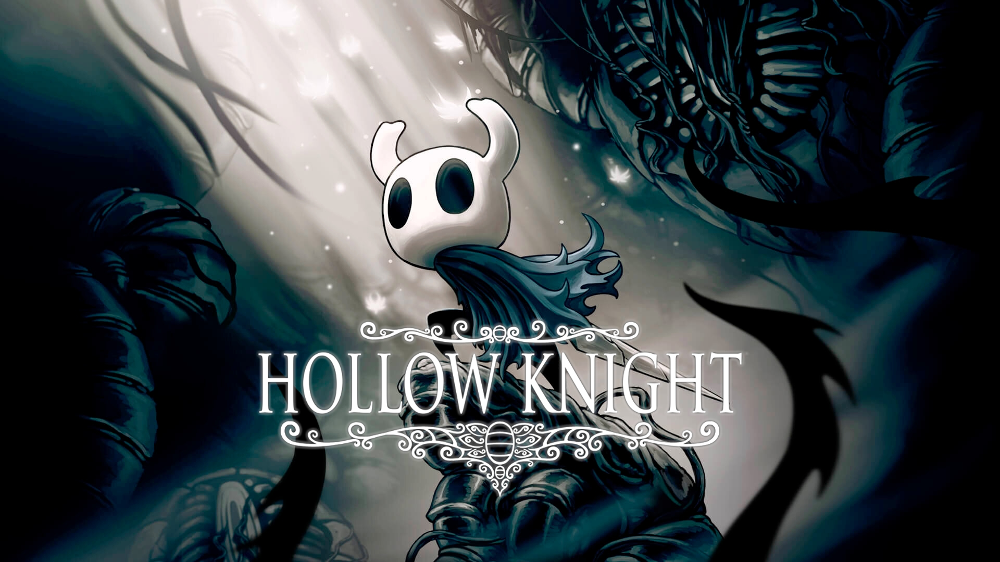

# Hollow Knight - Manual de Jogo

## Introdução

Bem-vindo ao Manual de Hollow Knight, um jogo de ação e aventura desenvolvido pela Team Cherry. Neste manual, vais encontrar informações essenciais sobre o jogo, incluindo mecânicas de combate, exploração, habilidades e dicas para progredir no mundo de Hallownest.

## Índice

* [Introdução](introducao.md)
* [Personagens](personagens.md)
* [História](historia.md)

## Características do Jogo

**Gênero:** Ação, Aventura, Metroidvania
**Perspetiva:** 2D, Plataformer
**Desenvolvimento:** Team Cherry, com apoio de fans kickstarter
**Jogabilidade:** Exploração, Combate, Colecionáveis, Habilidades e Upgrades

## Objetivo do Manual

Este manual tem como objetivo fornecer aos jogadores uma compreensão abrangente do jogo Hollow Knight, ajudando-os a navegar pelo mundo de Hallownest, enfrentar inimigos difíceis e descobrir os segredos escondidos. Além disso, o manual serve como um guia para novos jogadores e uma referência para veteranos que desejam aprimorar suas habilidades e estratégias.

## Fontes principais

- [Hollow Knight Wiki](https://hollowknight.fandom.com/wiki/Hollow_Knight_Wiki)
- [Team Cherry Official Website](https://www.teamcherry.com.au/)
- [MobyGames - Hollow Knight](https://www.mobygames.com/game/hollow-knight)

---
*Trabalho realizado por: [Rodrigo Santos]*

>Infelizmente nao pode ir a aula portanto terei de fazer o trabalho sozinho :c - Rodrigo Santos
