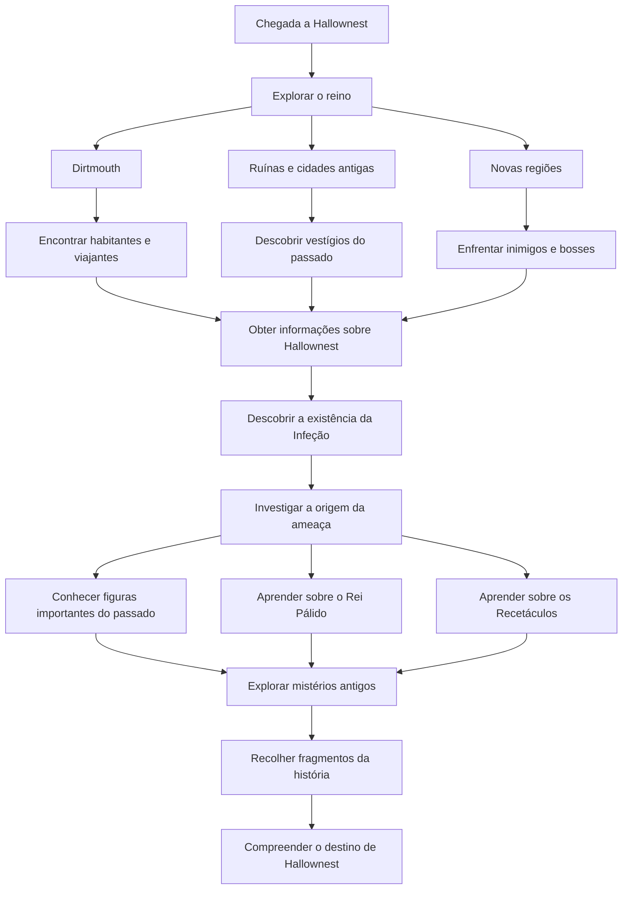

# História de Hollow Knight

## O Reino de Hallownest

A história de **Hollow Knight** decorre em **Hallownest**, um vasto reino subterrâneo que outrora foi uma civilização próspera e poderosa. No entanto, quando o jogador chega ao reino, encontra um lugar em ruínas, repleto de áreas abandonadas, criaturas hostis e vestígios de um passado glorioso.

Ao longo da exploração, é possível descobrir antigas construções, inscrições, memórias e personagens que revelam gradualmente a história e a queda de Hallownest.

## A Infeção

Um dos elementos centrais da narrativa é a misteriosa **Infeção**, uma doença que se espalhou por Hallownest e afetou a maioria dos seus habitantes.

As criaturas infetadas tornam-se agressivas, perdem a sua consciência e passam a agir apenas por instinto. A origem desta ameaça está ligada aos segredos mais profundos do reino, sendo um dos principais mistérios que o jogador procura desvendar.

## O Rei Pálido e os Recetáculos

O **Rei Pálido (Pale King)** foi o governante de Hallownest e uma das figuras mais importantes da sua história. Face à propagação da Infeção, tomou diversas medidas para tentar salvar o reino e preservar a sua civilização.

Entre essas medidas surgiu a criação dos **Recetáculos (Vessels)**, seres especiais relacionados com o Vazio (*Void*). O seu propósito está intimamente ligado às tentativas de conter a ameaça que assolava Hallownest.

Os acontecimentos envolvendo o Rei Pálido e os Recetáculos são fundamentais para compreender a origem da situação encontrada pelo jogador.

## O Papel do Jogador

O jogador controla o **Knight**, uma figura misteriosa que regressa a Hallownest após a sua queda.

Durante a aventura, o Knight explora novas regiões, enfrenta inimigos poderosos, derrota bosses e descobre fragmentos da história do reino. A narrativa é apresentada de forma indireta, através da exploração, dos diálogos das personagens, de inscrições antigas e de áreas secretas.

Esta abordagem incentiva os jogadores a investigarem cuidadosamente o mundo do jogo e a interpretarem por si próprios muitos dos seus mistérios.

## Narrativa e Exploração

Ao contrário de muitos jogos, **Hollow Knight** não apresenta toda a sua história através de cenas ou explicações diretas. Grande parte da narrativa está escondida nos detalhes do cenário, nas descrições de itens e nas interações com as personagens.

Esta forma de contar a história é um dos aspetos mais apreciados pelos fãs, recompensando a exploração e a atenção aos detalhes.

> **Nota:** Esta secção evita spoilers importantes sobre os acontecimentos finais e os diferentes finais do jogo.